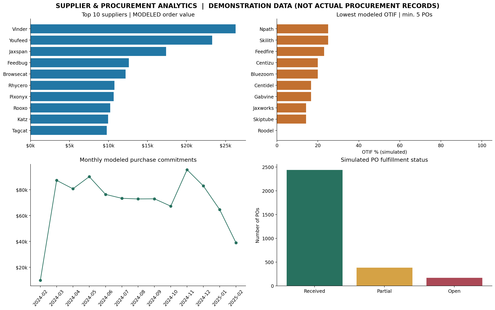

# Supplier Performance & Procurement Analytics Dashboard

**Python · SQL (SQLite) · Excel · Power BI · Streamlit**

> **Portfolio simulation — NOT historical procurement records.** This project combines a user-provided grocery inventory dataset with **deterministically generated, hypothetical purchase orders**. Modeled spend, delivery timeliness, fulfillment and savings are *not observed business outcomes*. Only source inventory fields and direct inventory-derived metrics are observational.



## Business objective

Build a supplier risk and procurement visibility demonstration: rank suppliers by modeled committed purchase order value, calculate simulated on-time/in-full (OTIF) and unit fill performance, identify hypothetical delivery/fulfillment risks, and prioritize inventory lines requiring replenishment. Provide executive KPIs, interactive drilldowns, SQL analyses and a repeatable data pipeline.

## Source and crucial caveats

`data/raw/grocery_inventory_source.csv` is the provided **990-row grocery inventory file**. It contains 350 distinct supplier names, inventory/product records, prices and several date fields, **but does not have actual PO IDs, promised delivery dates, paired receipts, procurement purchase costs, or actual PO fulfillment**. Specifically, **514/990** rows have `Date_Received` earlier than `Last_Order_Date`; those dates are not valid evidence of supplier lead time. `Supplier_ID` is unique for every source row, so `Supplier_Key` is generated from a normalized supplier **name** for descriptive grouping, not claimed to be a real supplier master ID. The `percentage` column has unclear semantics and is excluded from KPI computations.

**This repository adds a separately labeled synthetic fact table:** `data/processed/purchase_orders_SIMULATED.csv`. It is generated with seed `2026` and scenario reference date `2025-03-31`. All PO dates, quantities, cost estimates and delivery events in that table are modeled, not actual. Read [methodology](docs/METHODOLOGY_AND_LIMITATIONS.md) before interpreting dashboard metrics.

## Headline results (calculated from this run)

| KPI | Value | Evidence type |
|---|---:|---|
| Inventory lines | **990** | Observed |
| Distinct supplier names | **350** | Observed (not verified entities) |
| Low-stock lines eligible for restocking | **292** | Derived from source inventory (excludes discontinued) |
| Inventory value at listed price | **$332,654.71** | Price × stock quantity proxy, not accounting value |
| Purchase orders | **2,990** | **Simulated** |
| Total ordered value | **$912,896.42** | **Simulated**, not actual spend |
| OTIF | **59.50%** | **Simulated** |
| On-time rate | **68.63%** | **Simulated** |
| Unit fill rate | **91.15%** | **Simulated** |
| Open orders | **171** | **Simulated** |
| Top-10 suppliers' modeled spend share | **15.67%** | **Simulated** |
| Scenario savings at 5% renegotiation for top 10 suppliers | **$7,153.66** | **Hypothetical opportunity**, NOT achieved savings |

Figures are reproducible by running the pipeline with the included data and seed. Neither the simulated risks nor opportunities should be presented as actual supplier performance.

## Repository layout

```text
Supplier_Performance_Procurement_Analytics/
├── app.py                                # Interactive Streamlit dashboard
├── src/pipeline.py                       # Cleaning, PO simulation, KPIs, SQLite, charts
├── tests/test_pipeline.py                # Data contracts + reconciliation tests
├── data/
│   ├── raw/grocery_inventory_source.csv  # Original uploaded snapshot
│   └── processed/
│       ├── inventory_clean.csv           # Observed + clearly marked derived columns
│       ├── purchase_orders_SIMULATED.csv # Explicitly synthetic PO-level fact table
│       ├── dim_product.csv
│       └── dim_supplier.csv
├── outputs/                               # KPI files, supplier scorecards, checks
├── sql/analytics_queries.sql             # Seven reusable analytical SQL queries
├── powerbi/
│   ├── BUILD_GUIDE.md                     # Power BI visual/model setup
│   └── measures.dax                       # DAX KPI formulas + date table
├── reports/Procurement_Analytics_Workbook.xlsx
├── charts/procurement_dashboard_preview.png
├── docs/                                  # Data dictionary, assumptions and interview notes
├── procurement_analytics.sqlite
└── requirements.txt
```

## Run it locally (Windows PowerShell / VS Code)

```powershell
# In the project folder:
py -m venv .venv
.\.venv\Scripts\Activate.ps1
python -m pip install -r requirements.txt
python -m src.pipeline
python -m pytest -q
streamlit run app.py
```

If PowerShell prevents activation, use `.\.venv\Scripts\python.exe -m pip install -r requirements.txt` and `.\.venv\Scripts\python.exe -m src.pipeline` directly. To run Streamlit without activation: `.\.venv\Scripts\python.exe -m streamlit run app.py`.

For Mac/Linux: `python3 -m venv .venv && source .venv/bin/activate` and run the same `python -m ...` commands.

Your local browser opens an interactive Streamlit procurement dashboard with category, supplier and month filters. **The CSV and SQLite outputs are committed so the Power BI dashboard can be built without first executing the Python scripts.**

## SQL

SQLite database: `procurement_analytics.sqlite`. Open it with DB Browser for SQLite or the `sqlite3` command-line utility:

```bash
sqlite3 procurement_analytics.sqlite < sql/analytics_queries.sql
```

Queries provide modeled supplier scorecards, procurement spend trends, open/partial PO action queues, category spend, hypothetical 5% top-supplier negotiation savings and genuine inventory reorder risks.


## KPI definitions

- **On-time rate** = POs with simulated receipt date on/before simulated promised date ÷ all modeled POs due at the scenario reference date.
- **In-full rate** = POs with modeled received units ≥ ordered units ÷ due POs.
- **OTIF** = orders meeting both conditions ÷ modeled POs due; unreceived open POs count as failures.
- **Unit fill rate** = SUM(modeled received units) ÷ SUM(modeled ordered units), weighted by units.
- **Modeled ordered value** = simulated unit cost × simulated ordered units; does **not** measure historical paid spend.
- **Eligible low-stock inventory** = stock below reorder level AND status != discontinued; a purely source-backed rule.
- **Savings scenario** = 5% × simulated order value among the 10 suppliers with the highest simulated commitments, not realized savings.
- **Supplier risk** = illustrative OTIF rule only where at least 5 modeled POs; high below 65%, medium 65–under 85%, low ≥85%.

